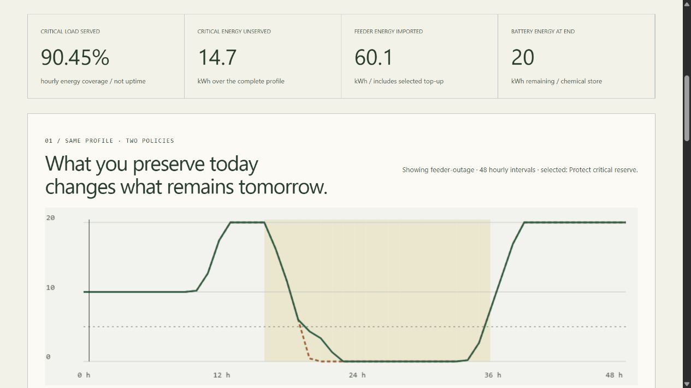

# Resilient Energy Microgrid Lab · FIELDGRID

An offline energy-accounting workbench by **Jason Stys**. Explore how renewable output, battery limits, feeder interruptions and critical/flexible loads interact at a fictional remote research station. Compare two transparent dispatch policies from the same starting state, inspect hourly flows, and export reproducible evidence.



## Use it

Download the ZIP for your OS from [Releases](https://github.com/JasonStys/resilient-energy-microgrid-lab/releases), verify its adjacent SHA-256 file, and extract the **entire** archive. Launch `ResilientEnergyMicrogridLab` (Windows: `.exe`) to open the local browser UI. No Python/Node installation, admin rights, account, cloud service or Docker is required for the portable app. Quit with Ctrl+C in its console. Unsigned software may trigger OS warnings; verify the source/checksum and do not bypass your organization's controls. Desktop Windows x64, Linux x64 and macOS arm64 are the release targets, not universal binaries or mobile installers.

Source setup with Python 3.12–3.14 and Node 24:

```text
python -m venv .venv
# Activate the environment using the command for your shell.
python -m pip install --require-hashes -r requirements-dev.lock
npm ci
npm run build
python -m gridlab serve
```

## What it demonstrates

- Python production dispatch and a separately implemented exact-rational reference, checked on every run.
- Capacity, initial energy, charge/discharge rates, efficiency losses, feeder caps, unavailable batteries and protected flexible-load reserves.
- Six fictional scenarios; 648 finite control combinations. Both heuristics prioritize critical load; only one restricts flexible battery service to preserve reserve.
- TypeScript/HTML/CSS UI with real Canvas energy traces, hourly inspector, policy comparison, keyboard/mobile layouts and help.
- Full JSON evidence, both-policy CSV, inert HTML, editable input JSON, and optional immutable SQLite history.
- Bounded local inputs, read-only loopback HTTP, pinned tooling, cross-platform CI, CodeQL and draft-gated portable releases without Actions artifact/cache uploads.

## Example and interpretation

With default settings, protected-reserve dispatch supplies **90.454545%** of critical energy versus **88.181818%** for serve-all dispatch over the 48-hour feeder-outage profile. It leaves **14.7 kWh** versus **18.2 kWh** critical energy unserved, while shedding more flexible demand. The first critical-shortfall slot is hour 22 versus 20. Neither policy is universally best, and a single profile is not a reliability probability or optimization proof. Full regression summaries are in [benchmark evidence](docs/reports/benchmark.json).

```text
python -m gridlab export --format input --output editable.json
python -m gridlab export --input editable.json --output evidence.json --history private.sqlite3
python -m gridlab export --scenario winter-drought --format csv --output drought.csv
```

Outputs are create-only; SQLite is explicit, unencrypted and local, with no automatic pruning. Do not submit sensitive infrastructure data.

## Verify and navigate

```text
python -m ruff check gridlab tests tools launcher.py
python -m ruff format --check gridlab tests tools launcher.py
python -m mypy gridlab
python tools/verify_repo.py
python -m pytest --cov=gridlab --cov-report=term-missing
python -m tools.benchmark
npm run format:check
npm test
npm run build
npx playwright install chromium firefox webkit
npm run test:e2e
npm run audit
python -m pip_audit --disable-pip --no-deps -r requirements-dev.lock
python tools/package_app.py
```

Main files: `gridlab/model.py` validates and builds profiles; `dispatch.py` allocates source-first flows; `reference.py` independently allocates load-first rational flows; `engine.py` checks ledgers, compares policies and summarizes; `reports.py` exports/stores evidence; `server.py` confines local HTTP; `__main__.py` provides CLI; `web/main.ts` renders the workbench; `web/contracts.ts` guards responses; `tools/` validates inventories, benchmarks, packaging and release gates. Every file and exact function/variable location is indexed below.

[User guide](docs/USER_GUIDE.md) · [Model/units](docs/MODEL.md) · [Architecture](docs/ARCHITECTURE.md) · [API/input schema](docs/API.md) · [Validation results](docs/VALIDATION.md) · [Release procedure](docs/RELEASE.md) · [File catalog](docs/FILE_CATALOG.md) · [Exact code index](docs/CODE_INDEX.md) · [Security](SECURITY.md) · [Third-party notices](docs/THIRD_PARTY.md)

## Boundaries and contact

Synthetic civilian education only: no real telemetry, electrical control, power-flow solver, protection model, forecasts, battery certification, site calibration, reliability guarantee or optimal scheduling. Hourly energy adequacy does **not** establish electrical safety. Not affiliated with or endorsed by a government agency, employer, laboratory or equipment vendor.

Created by [Jason Stys](https://github.com/JasonStys). [Questions/issues](https://github.com/JasonStys/resilient-energy-microgrid-lab/issues) · [LinkedIn](https://www.linkedin.com/in/jason-stys-31b30b351/). MIT license; retain bundled runtime notices.
